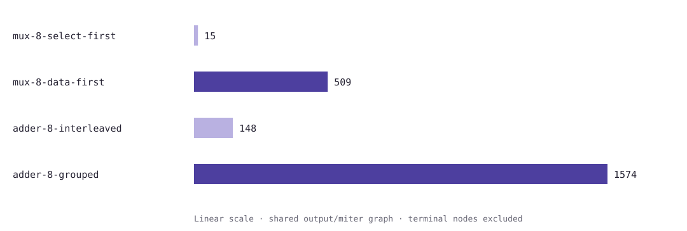

# Boolean circuit equivalence lab

**[View the report in your browser](https://Michaelhoang8.github.io/boolean-circuit-equivalence-lab/)**

A bounded **reduced ordered binary decision diagram (ROBDD)** engine and combinational circuit checker in TypeScript. It compiles both circuits into one fixed-order manager, constructs an XOR/OR output miter, and returns `EQUIVALENT`, `INEQUIVALENT` with a replayed assignment, or `UNKNOWN` when a resource budget prevents completion.

**[Technical report](docs/report.html)** · [Screenshots](docs/screenshots/README.md) · [Review recording](docs/recordings/README.md) · [Specification](docs/specification.md)



## Executed results

| Comparison | Result | Allocated nodes | Reachable nodes |
| --- | --- | ---: | ---: |
| 2-bit ripple / parallel prefix, interleaved | Equivalent | 33 | 19 |
| 4-bit ripple / parallel prefix, interleaved | Equivalent | 118 | 50 |
| 4-bit ripple / faulty carry | Inequivalent | 95 | 69 |
| 8-bit ripple / parallel prefix, interleaved | Equivalent | 460 | 148 |
| 8-bit ripple / parallel prefix, grouped | Equivalent | 4,987 | 1,574 |
| 12-bit ripple / parallel prefix, interleaved | Equivalent | 1,034 | 294 |
| Mux2 tree / sum of products, selector first | Equivalent | 7 | 3 |
| Mux8 tree / sum of products, selector first | Equivalent | 96 | 15 |
| Mux8 tree / sum of products, data first | Equivalent | 820 | 509 |
| Mux8 data first, 100-node limit | **UNKNOWN** | 100 | Unresolved |
| Mux8 selector first, zero cache entries | **UNKNOWN** | 12 | Unresolved |

All counts exclude the two terminals. **Allocated** includes every nonterminal created during both compilations and miter construction, including intermediates retained by the manager. **Reachable** is the union from both circuits' output roots, per-output difference roots and the final miter. It is not a sum of separately duplicated output graphs or an estimate of JavaScript heap bytes.

The faulty four-bit adder replaces the carry-combining OR with AND at bit 2. The first witness in the declared false-first variable order is `A=4, B=4, cin=0`: ripple output is 8, faulty output is 0, and output `s3` differs. **256 of all 512 assignments** expose this mutant. [Counterexample and graph](results/comparisons/adder-4-faulty.json) · [All 512 assignments](results/truth-tables/adder-4-faulty.csv).

The evidence contains **11 experiments, 99 measured runs and 9,256 original truth-table rows**. Some rows repeat across order/budget experiments; this is the number retained, not a claim of unique logical assignments across the study. Larger adders are checked symbolically and are not represented as exhaustively truth-table-tested.

## Reproduce

Requires **Node 24**. Runtime execution uses Node's native TypeScript stripping and built-ins; pinned TypeScript and Node types provide separate strict static checking.

```sh
npm ci --ignore-scripts
npm run typecheck
npm test
npm run measure -- --output results-local
```

These commands work in PowerShell and POSIX shells. A fresh measurement directory is ignored by Git. CI tests the preserved evidence, then generates a fresh result set on both Ubuntu and Windows. There are no timing thresholds.

To deliberately replace the committed measurements:

```sh
npm run measure
npm run report
```

`npm run generate` recreates all 13 synthetic circuit files and the fixed experiment list. Measurement reads those files rather than silently replacing them. `npm run report` only reads recorded measurements; presentation edits do not replace timings. Normalized source/input hashes are in [environment.json](results/environment.json); report and SVG hashes have a separate [manifest](docs/figures/manifest.json).

## CLI

```sh
npm run cli -- compare data/circuits/adder_4_ripple.json data/circuits/adder_4_prefix.json
npm run cli -- compare data/circuits/adder_4_ripple.json data/circuits/adder_4_faulty.json
npm run cli -- compare data/circuits/mux_8_tree.json data/circuits/mux_8_terms.json --order d0,d1,d2,d3,d4,d5,d6,d7,s0,s1,s2 --max-nodes 100
npm run cli -- replay data/circuits/adder_4_ripple.json data/circuits/adder_4_faulty.json results/comparisons/adder-4-faulty.json
```

`compare` prints JSON diagnostics. Input/output names must agree, and `--order` must be an exact permutation of inputs; the default is the left circuit's declared input order. `--max-nodes` and `--max-cache` set explicit nonnegative resource budgets. The maximum accepted limits are 100,000 nodes and 200,000 computed-cache entries.

| Exit | Meaning |
| ---: | --- |
| 0 | Equivalent comparison, successful counterexample replay, or help. |
| 1 | Inequivalent comparison; inspect the concrete witness. |
| 2 | Invalid input or execution error. |
| 3 | UNKNOWN because a budget prevented the BDD check from completing. |

`replay` uses only the saved assignment and the direct gate evaluator. It recalculates outputs instead of trusting saved output values. It establishes that this input distinguishes the supplied circuits; it does not authenticate the file, independently prove BDD canonicity or verify an arbitrary equivalence certificate. Invalid arguments and files produce concise errors without stack traces. `npm run cli -- --help` lists the commands.

## Method and design choices

- **Fixed variable order.** Each manager owns one immutable copy of its order. Terminal IDs are 0 and 1. A nonterminal stores variable level, false child and true child; edges always descend to a later level.
- **Reduction and sharing.** Equal children eliminate the node. The unique table interns `(level, low, high)` triples. Commutative `and`, `or` and `xor` applications normalize operand order and memoize results. NOT is XOR with 1; mux is `(!select AND low) OR (select AND high)`.
- **Named-output miter.** Both circuits compile into the same manager. For each output, calculate `left XOR right`; OR all differences. A zero root establishes equivalence for every Boolean input assignment under this gate model, subject to implementation correctness. No sampling or probability is involved in that conclusion.
- **Replayable inequivalence.** A nonzero miter gives a false-first satisfying path. Skipped variables become false. The direct Boolean evaluator independently replays every gate in both circuits and must confirm at least one different output before returning `INEQUIVALENT`.
- **Explicit incompleteness.** A failed node/cache allocation becomes `UNKNOWN`, with the resource and compilation/miter stage. It returns no miter or witness. The same small fixture can independently pass a truth-table check while its budget-limited BDD result remains UNKNOWN.

Node IDs are **manager-local handles**. The API detects out-of-range IDs, but a foreign manager's coincident numeric ID cannot be distinguished at runtime; passing it is caller misuse. Cross-manager numeric equality is not an equivalence check. Public diagnostics and configuration getters return copies. Discard a manager after a `BudgetExceeded` exception; low-level operations can leave valid intermediate nodes allocated even when the requested operation did not finish.

The circuit format supports constants, NOT, two-input AND/OR/XOR and a three-input mux. Gates must be in topological order; forward references and cycles fail validation. Output comparison is by name, not array position. [The specification](docs/specification.md) defines exact field, size and JSON-token restrictions.

The alternative adder uses parallel prefix rounds for group generate/propagate, rather than following the ripple carry recurrence. Fixtures share the input XOR/AND definitions but construct carry dependencies differently. An independent integer-addition oracle checks every input of widths 1–4. Multiplexer alternatives use a mux tree and a sum of product terms; the test oracle computes the numeric selector and reads the chosen data input directly.

## Validation and preserved evidence

Tests cover every primitive gate truth table, reduction/sharing, cache reuse, fixed-order structure, input/schema failures, configuration/diagnostic mutation isolation, node/cache exhaustion, full witness replay and small arithmetic/multiplexer correctness.

An independent review test builds **all 256 Boolean functions on three variables** through Shannon decomposition. It checks 2,048 direct evaluations, 256 complements, 256 false-first witnesses (including unsatisfiable null), unique canonical roots and **196,608 pair-operation comparisons** against bit-vector truth tables: all 65,536 ordered pairs × AND/OR/XOR. This bounded exhaustive check strengthens confidence without proving the implementation correct for arbitrary input sizes.

Preserved-evidence tests additionally:

- verify normalized source/input, comparison, report and SVG hashes;
- rerun every experiment and compare all diagnostics except elapsed time;
- independently traverse saved node graphs and verify reduction, unique triples and strict level ordering;
- match all original small-circuit truth-table rows and miter values;
- reconcile all 99 timing rows with per-experiment counts and min/median/max.

## Artifacts and measurements

| File | Contents |
| --- | --- |
| [data/circuits/](data/circuits/) | Original readable gate-list circuit fixtures. |
| [data/experiments.json](data/experiments.json) | Every pair, exact order, resource limit and oracle flag. |
| [results/summary.json](results/summary.json) | Status, allocated/reachable counts, timing ranges and truth-table coverage. |
| [results/comparisons/](results/comparisons/) | Actual root maps, reachable node triples and concrete witnesses, or explicit UNKNOWN diagnostics. |
| [results/truth-tables/](results/truth-tables/) | Full original Boolean assignments and outputs encoded as compact CSV bit strings. |
| [results/timings.csv](results/timings.csv) | Nine recorded repetitions per experiment. |
| [results/environment.json](results/environment.json) | Runtime/CPU/platform and input/source SHA-256 values. |
| [docs/figures/mux2-bdd.dot](docs/figures/mux2-bdd.dot) | Small actual graph in portable DOT form, with an SVG rendering. |

Each experiment receives two warm-ups, then nine runs with a **fresh manager**. Timing starts after initial schema/compatibility validation and manager creation; it covers compilation (including compiler-side revalidation), miter construction and direct replay when a witness exists. It excludes reachable-node export, full truth-table enumeration, file writes and rendering. Runtime/JIT/GC and execution order affect these small durations. Counts demonstrate the variable-order tradeoff more clearly than sub-millisecond timing differences.

Raw truth-table bit strings are ordered by the `inputOrder` and `outputOrder` arrays in that experiment's summary. The leftmost input is the most significant enumeration position, with false before true. Adder signal suffixes retain their separate arithmetic meaning: `a0`/`b0`/`s0` are least significant bits, and `cout` is the extra output bit.

## Limits and provenance

This is a two-valued combinational Boolean model, limited to 1–32 inputs, 512 gates and 33 outputs. No sequential state, clock, latch, tri-state/X/Z semantics, signed arithmetic convention, electrical behavior, hardware timing or synthesis integration is modeled. Resource limits are operational bounds, not evidence of a property. There is no automatic reordering, complemented-edge representation, node garbage collection, SAT dependency or unbounded resource guarantee.

The roots and graph snapshots are implementation diagnostics, not signed proof certificates or proofs checked by an external theorem prover. Larger symbolic results rely on the correctness of this implementation; the independent exhaustive oracles cover the explicitly reported small domains only.

Primary reference: Randal E. Bryant, [Graph-Based Algorithms for Boolean Function Manipulation](https://www.cs.cmu.edu/~bryant/pubdir/ieeetc86.pdf), *IEEE Transactions on Computers*, C-35(8), 677–691, 1986. The implementation uses the paper's reduced ordered graph/canonical representation and recursive Boolean operation concepts, without claiming to reproduce its experimental system or benchmarks.

This is **AI-assisted portfolio work** with synthetic circuits created for this repository. Results come from actual local execution; no physical hardware testing, production verification impact or historical manual design process is claimed. Captures show review of this report. Text and SVG hashes normalize CRLF to LF; environment metadata excludes usernames, hostnames and personal paths.
